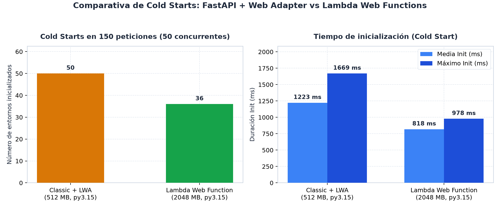
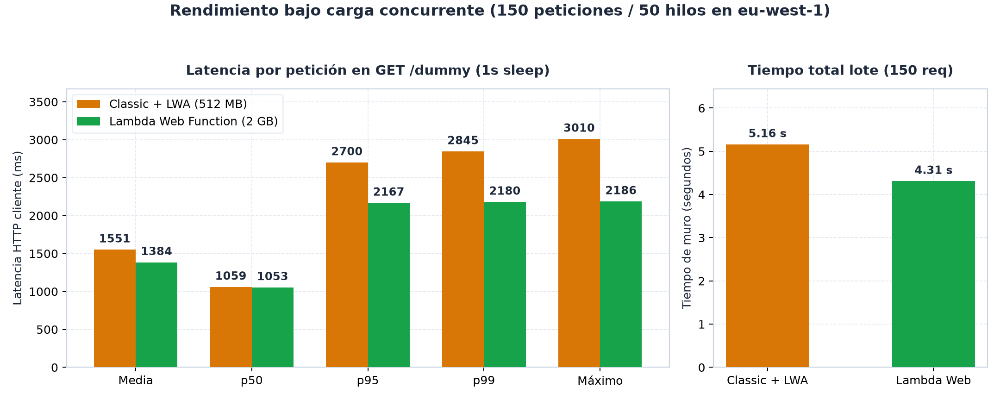
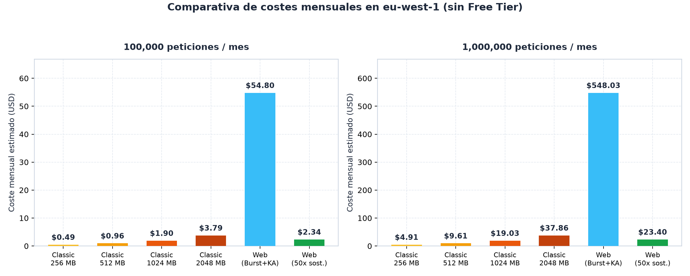

Si alguna vez has intentado ejecutar **FastAPI** sobre AWS Lambda, ya sabes cuál ha sido el camino oficial durante los últimos años: o reescribes tu entrypoint con `Mangum`, o tiras del clásico **AWS Lambda Web Adapter (LWA)** en modo *Layer* junto a `uvicorn` para que traduzca los eventos de Function URL o API Gateway a tráfico HTTP local.

Funciona, sí. Pero hay que pagar un precio: cada petición concurrente levanta su propio contenedor con **Uvicorn \+ el proxy en Rust del Web Adapter**, y AWS te cobra cada milisegundo de reloj completo aunque tu `async def` esté simplemente esperando I/O en un `await`.

Ahora AWS ha presentado **Lambda Web Functions**, un nuevo modelo nativo pensado para ejecutar frameworks web HTTP. Inicialmente se presentó solo en NodeJS, pero ahora es compatible con python, **sin adaptadores, sin Uvicorn empaquetado a mano y facturando por CPU activa**.

¿Merece la pena jubilar el Lambda Web Adapter?  
He montado una comparativa completa en **eu-west-1** con Terraform, lanzado **150 peticiones concurrentes (50 hilos simultáneos)** contra ambas Lambdas y auditado cada milisegundo en CloudWatch.

---

## Descripción de la funcionalidad de Lambda Web Functions

**AWS Lambda Web Functions** introduce un tipo de función específica en AWS Lambda orientada a cargas HTTP nativas, con recursos propios en la API de AWS y en Terraform (`aws_lambdaweb_function`, `aws_lambdaweb_function_revision` y `aws_lambdaweb_function_endpoint`).

Sus características principales frente a una Lambda clásica (*Event Function*) son:

1. **ASGI/WSGI nativo sin adaptadores ni Uvicorn**: en Python (actualmente en *preview* con el runtime `python3.15`), Lambda arranca el servidor HTTP gestionado directamente buscando `app` en `main.py` (`main:app`). Solo empaquetas `fastapi` y sus dependencias: adiós al *Layer* de Lambda Web Adapter, adiós a `AWS_LAMBDA_EXEC_WRAPPER` y adiós a `run.sh`.  
2. **Hardware fijo en Arm64 (Graviton)**: cada entorno de ejecución tiene tamaño fijo de **2 GB de RAM y 2 vCPUs Arm64**. No se configura la memoria ni el tamaño del contenedor.  
3. **Múltiples peticiones por entorno**: mientras una Lambda clásica atiende una única petición simultánea por microVM, una Lambda Web Function puede atender por defecto hasta **64 peticiones concurrentes** (`max_concurrency_per_environment`, configurable de 1 a 128\) dentro de un mismo entorno caliente.  
4. **Facturación desacoplada** (Precios para Irlanda):  
   - **CPU activa**: Se factura mientras el código usa CPU (las esperas asíncronas de red/I/O casi no consumen CPU), \$0.0000291572 vCPU por segundo  
   - **Memoria del entorno**: \$0.0000038603 **GB-segundo** por los **2 GB fijos** durante toda la vida del entorno mientras está activo o caliente en *keep-alive*. Esto es importante, en lambda events que la función se mantuviera caliente entre peticiones, no se cobraba.  
   - **Peticiones**: **`$0.30` por millón de peticiones** (frente a `$0.20` / millón en Lambda clásica).  
5. **Revisiones inmutables en S3 y endpoints desacoplados**: el código ZIP de cada revisión se referencia desde un bucket S3 con **versionado habilitado** y una *bucket policy* que permite lectura a `lambda.amazonaws.com`, exponiéndose mediante un endpoint `HomeRegion` o `MultiRegion` con autenticación `ApplicationManaged` (pública / gestionada por la app) o `IamAuth` (SigV4).

---

## Descripción de la solución implementada

Para comparar ambos enfoques en igualdad de condiciones, desplegamos dos funciones minimalistas en **Irlanda (`eu-west-1`)**, ambas sobre arquitectura **Arm64** y expuestas mediante URLs HTTPS públicas:


*(El diagrama editable completo está en [`docs/architecture.drawio`](http://docs/architecture.drawio)).*

### 1\. La aplicación FastAPI (`GET /dummy`)

Ambas Lambdas exponen exactamente el mismo endpoint `GET /dummy` con una espera asíncrona fija de **1 segundo** (`await asyncio.sleep(1.0)`) para simular una consulta típica a base de datos o API externa, devolviendo un JSON con el tiempo de ejecución medido dentro de la app y el ID de instancia:

```py
@app.get("/")
async def health():
    """Fast readiness check endpoint."""
    return {"status": "ok", "mode": "lambdaweb", "instance_id": INSTANCE_ID}


@app.get("/dummy")
async def dummy():
    """Simulate async I/O work and return JSON with the measured execution time."""
    start = time.perf_counter()
    await asyncio.sleep(DELAY_SECONDS)
    execution_time_ms = round((time.perf_counter() - start) * 1000, 2)

    payload = {
        "message": "Hello from AWS Lambda Web Functions (FastAPI)",
        "mode": "lambdaweb",
        "execution_time_ms": execution_time_ms,
        "delay_seconds": DELAY_SECONDS,
        "instance_id": INSTANCE_ID,
    }
    logger.info(json.dumps({"event": "dummy_request", **payload}))
    return payload
```

&nbsp;

### 2\. Empaquetado para Arm64 e  Infraestructura con Terraform

&nbsp;

- **Package\_lambdas.py** empaqueta las dos lambdas para arm64. Podría haberlo hecho con AWS SAM, pero mi LLM de confianza ha acertado a la primera, así que lo he dejado pasar.  
- **Rama clásica (`terraform/events_fastapi.tf`)**: Python 3.13 (el que tengo instalado en el portátil), **512 MB** en `arm64` y el *Layer* oficial de AWS Lambda Web Adapter.  Luego me he dado cuenta que lo correcto era usar python 3.15 pero ya tenía el artículo casi escrito,  no creo que tenga impacto en rendimiento.&nbsp;  
- **Rama Lambda Web Function (`terraform/web_fastapi.tf`)**: Obliga a usar python 3.15 y a subir el paquete a un s3 con control de versiones activado.  
- &nbsp;

```hcl
resource "aws_lambdaweb_function_revision" "web_fastapi" {
  function_name = aws_lambdaweb_function.web_fastapi.function_name
  description   = "Native Python 3.15 ASGI FastAPI app running on AWS Lambda Web Functions."

  build_config {
    code_config {
      s3_object {
        bucket     = aws_s3_bucket.web_artifacts.id
        key        = aws_s3_object.web_fastapi_zip.key
        version_id = aws_s3_object.web_fastapi_zip.version_id
      }
    }

    runtime_config {
      runtime = "python3.15"
    }
  }

  service_config {
    execution_role_arn              = aws_iam_role.web_fastapi.arn
    timeout_seconds                 = 30
    max_concurrency_per_environment = 64

    environment_variables = {
      DELAY_SECONDS = "1"
    }
  }
}
```

&nbsp;

---

## Comparación de tiempos de ejecución entre la Lambda normal y la Lambda Web Function

La prueba consiste en 150 **peticiones `GET al endpoint /dummy`** con **50 hilos concurrentes** contra cada función (con una pausa intermedia de 75 s para aislar las métricas en CloudWatch).

Ambas funciones devolvieron **150/150 respuestas HTTP 200**.

### 1\. Cold Starts: número de arranques y tiempo de inicialización



| Métrica de Cold Start (CloudWatch) | Classic \+ LWA (`512 MB`, `py3.13`) | Lambda Web Function (`2048 MB`, `py3.15`) |
| :---- | ----: | ----: |
| **Entornos inicializados (Cold Starts)** | **49** *(de 150 invocaciones)* | **35** |
| **Init Duration mínima** | 938.41 ms | **650.00 ms** |
| **Init Duration media** | 1,101.03 ms | **828.54 ms** |
| **Init Duration p50 / p95** | 1,025.43 ms / 1,267.96 ms | **878.00 ms / 972.70 ms** |
| **Init Duration máxima** | 1,279.85 ms | **1,002.00 ms** |
| **Memoria máxima usada (pico)** | **87 MB** (de 512 MB) | **197 MB** (de 2,048 MB) |

**Dos lecturas muy interesantes aquí:**

- **Arranque un 25% más rápido en Web Functions**: de media, inicializar FastAPI de forma nativa en Lambda Web Functions tardó **`828.54 ms`** frente a **`1,101.03 ms`** levantando Uvicorn \+ el proxy de Lambda Web Adapter en 512 MB (donde además cuentan los 2 vCPUs del entorno de 2 GB).  
- **Por qué Lambda Web Functions levantó 35 entornos (y no 1\)**: al recibir 50 peticiones simultáneas **desde cero en frío** en cuestión de milisegundos, el enrutador de Lambda Web Functions no deja a 49 clientes bloqueados esperando el arranque de una sola instancia; escala en paralelo hasta **35 entornos** (`EnvironmentConcurrentRequests` máximo observado \= **2.0** durante la ráfaga inicial). Eso protege la latencia de cola, pero tiene un impacto directo en la factura.

### 2\. Tiempos medios, percentiles y tiempo total del lote



| Métrica de rendimiento (150 req / 50 concurrentes) | Classic \+ LWA | Lambda Web Function | Mejora |
| :---- | ----: | ----: | ----: |
| **Tiempo total de muro del lote** | **10.72 s** (`10,717.08 ms`) | **4.61 s** (`4,608.08 ms`) | **2.33× más rápida** |
| **Latencia cliente — Mínima** | 1,132.56 ms | 1,127.61 ms | Igual |
| **Latencia cliente — Mediana (p50)** | 1,148.70 ms | 1,149.68 ms | Igual |
| **Latencia cliente — Media** | **3,459.46 ms** | **1,469.76 ms** | **2.35× más rápida** |
| **Latencia cliente — p95** | **8,261.43 ms** | **2,282.30 ms** | **3.62× más rápida** |
| **Latencia cliente — p99 / Máxima** | 8,318.15 / 8,401.07 ms | 2,299.30 / 2,307.94 ms | **3.64× más rápida** |
| **Handler en warm (`REPORT` / app)** | 1,003.49 ms *(media warm)* | 1,000.83 ms *(media app)* | Equivalente |

&nbsp;

Mientras el código FastAPI en caliente tarda prácticamente lo mismo (\~`1,001–1,003 ms`), la experiencia para los usuarios bajo un pico de tráfico en con arranques en frio cambia por completo: en **Classic \+ LWA**, el p95 se dispara por encima de **8.2 segundos** debido a *cold starts* \+ *readiness probe* interno del Web Adapter, mientras que **Lambda Web Functions** resuelve el **p99 en 2.30 segundos** y termina las 150 peticiones en menos de la mitad de tiempo.

---

## Comparación de costes

Veamos qué dicen los números reales de CloudWatch en `eu-west-1` (sin aplicar Always Free Tier):

- **Lambda clásica Arm64**: `$0.0000133334` / GB-segundo \+ `$0.20` / 1M peticiones.  
- **Lambda Web Functions**: `$0.0000291572` / vCPU-segundo activo \+ `$0.0000038603` / GB-segundo de memoria (**2 GB fijos**) \+ `$0.30` / 1M peticiones.

### 1\. Desglose real observado en CloudWatch (lote de 150 peticiones)

| Concepto medido en CloudWatch | Classic \+ LWA (`512 MB`) | Lambda Web Function (`2048 MB / 2 vCPU`) |
| :---- | ----: | ----: |
| **Invocaciones / Peticiones** | 150 | 150 |
| **Tiempo facturado / Vida de entornos** | `204.66 s` (`102.33 GB-s`) | `10,425.60 s` acumulados (`20,851.21 GB-s` con *keep-alive*) |
| **CPU activa (`EnvironmentCPUTime`)** | N/A *(paga duración completa)* | **`71.69 s`** *(0.48 s por petición incl. 35 inits)* |
| **Coste durante carga activa (estimado 4.61 s × 35 envs)** | `$0.001394` | `$0.003380` |
| **Coste real total en factura (con *keep-alive* de entornos)** | **`$0.001394`** | **`$0.082627`** |

&nbsp;

Aquí está la **gran problema de coste** del experimento:

1. Al recibir 50 peticiones de golpe en frío, Lambda Web Functions levantó **35 entornos de 2 GB** para servir el pico en 4.61 segundos.  
2. Después de responder la última petición en el segundo 4.61, esos **35 entornos permanecieron vivos en *keep-alive* durante \~298 segundos cada uno** (\~5 minutos de cortesía), acumulando **`10,425.60 segundos`** en `EnvironmentActiveTime` (`20,851.21 GB-s`).  
3. Como resultado, el **97.4% del coste (`$0.080492` de `$0.082627`)** no fue por ejecutar FastAPI ni por CPU activa (`$0.002090`), sino por mantener calientes los 35 entornos de 2 GB después del pico de peticiones.

Además en estos números no se tiene en cuenta la capa gratuita, las funciones de tipo web están excluidas del free tier.

### 2\. Proyección mensual: 10k, 100k y 1M peticiones/mes

Para entender dónde gana cada arquitectura, proyectamos las métricas reales medidas a **10,000**, **100,000** y **1,000,000 peticiones/mes** comparando la Lambda clásica \+ LWA en **256 MB, 512 MB, 1024 MB y 2048 MB** (con su media real de `1.3644 s` facturados) frente a dos escenarios de Lambda Web Functions:

- **Web (Burst \+ Keep-Alive)**: ráfagas aisladas en frío como la del test (`69.50 s` de entorno por petición contando el *keep-alive* de los 35 entornos).  
- **Web (Concurrencia 50x sostenida)**: tráfico continuo donde los entornos permanecen ocupados atendiendo peticiones concurrentes sin quedarse en *idle* desperdiciado (`1.075 s` de entorno/req \+ `0.4779 vCPU-s/req`).



| Peticiones / mes | Classic 256 MB | Classic 512 MB | Classic 1024 MB | Classic 2048 MB | Web (50x sostenida) | Web (Burst \+ Keep-Alive) |
| ----: | ----: | ----: | ----: | ----: | ----: | ----: |
| **10,000** | **\$0.05** | \$0.09 | \$0.18 | \$0.37 | \$0.23 | \$5.51 |
| **100,000** | **\$0.47** | \$0.93 | \$1.84 | \$3.66 | \$2.25 | \$55.08 |
| **1,000,000** | **\$4.75** | \$9.30 | \$18.39 | \$36.58 | \$22.54 | \$550.85 |

Obviamente este coste de 35 entornos “desperdiciados” y su proyección a más de \$550 en la proyección a un millón de llamadas es difícil que se de en un escenario real, pero ayuda a entender el problema.

**El punto de cruce FinOps**: si tu aplicación FastAPI en Lambda clásica corre cómoda en **256–512 MB** y tiene tráfico en ráfagas esporádicas, la Lambda clásica sigue siendo entre **2.4× y 59× más barata**. En cambio, si tu API necesita **2048 MB** (p. ej. modelos ML, procesamiento pesado o librerías grandes) y tiene tráfico concurrente sostenido (aprovechando hasta 64 peticiones por entorno), Lambda Web Functions reduce el coste en torno a un 38% (`$22.54` vs `$36.58` cada millón de peticiones) y elimina por completo la latencia extra del Lambda Web Adapter.

---

## Conclusiones

Después de medir `FastAPI + Lambda Web Adapter` frente a `AWS Lambda Web Functions` con tráfico concurrente real en `eu-west-1`, la fotografía sería la siguiente:

&nbsp;

**Lambda Web Functions es más sencillo**: elimina el *Layer*, elimina `uvicorn` del paquete, arranca un **25% más rápido** (`828 ms` vs `1,101 ms`) y recorta el **p95 a menos de un tercio** (`2.28 s` vs `8.26 s`) al completar 150 peticiones concurrentes en `4.61 s` frente a `10.72 s`.

1. **Cuidado con las ráfagas en frío desde cero si buscas ahorrar**: como Lambda Web Functions escala rápido en paralelo durante un pico en frío (35 entornos en nuestro test) y cada entorno cobra **2 GB fijos durante \~5 minutos de *keep-alive***, un servicio con picos puntuales seguidos de silencio puede salir **mucho más caro** que una Lambda clásica de 512 MB (`$0.0826` vs `$0.0014` en la prueba).  
2. **Cuándo elegir cada una**:  
   - **Elige Lambda clásica \+ LWA (256–512 MB)** para microservicios FastAPI pequeños, con tráfico intermitente o ráfagas esporádicas donde el coste manda y un p95 más alto en frío es asumible.  
   - **Elige Lambda Web Functions** cuando tengas tráfico web **sostenido con concurrencia**, necesites **baja latencia en p95/p99**, manejes cargas *I/O-bound* largas que hoy te obligan a pagar 1–2 GB de RAM en clásico, o quieras desplegar ASGI/Express estándar sin mantener adaptadores.  
3. **Madurez del runtime**: en `python3.15` AWS todavía emite un warning indicando que es *preview* (aún no recomendado para producción crítica), mientras que en Node.js (`nodejs24.x`) ya está listo para producción.

Tienes todo el código fuente (empaquetado en Python sin dependencias externas, Terraform, scripts de benchmark, análisis de CloudWatch y gráficos) en este repositorio para reproducir las pruebas en tu propia cuenta.